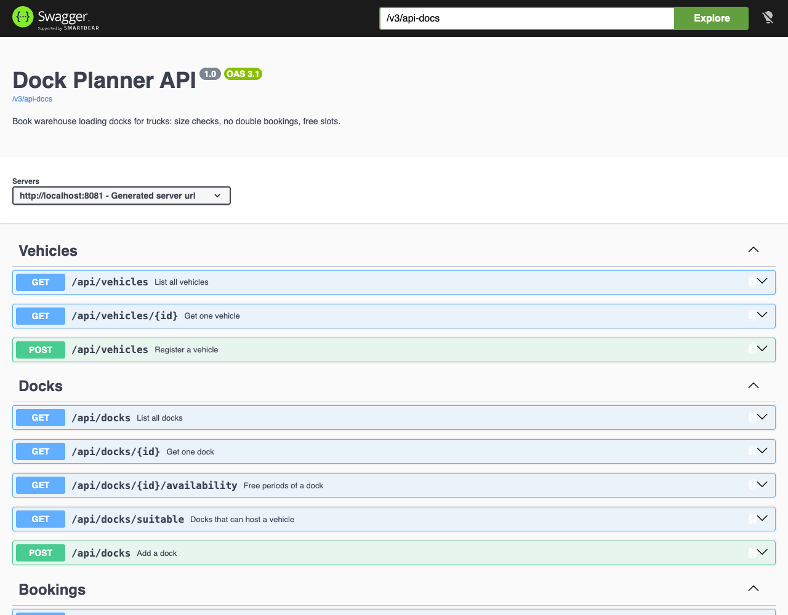
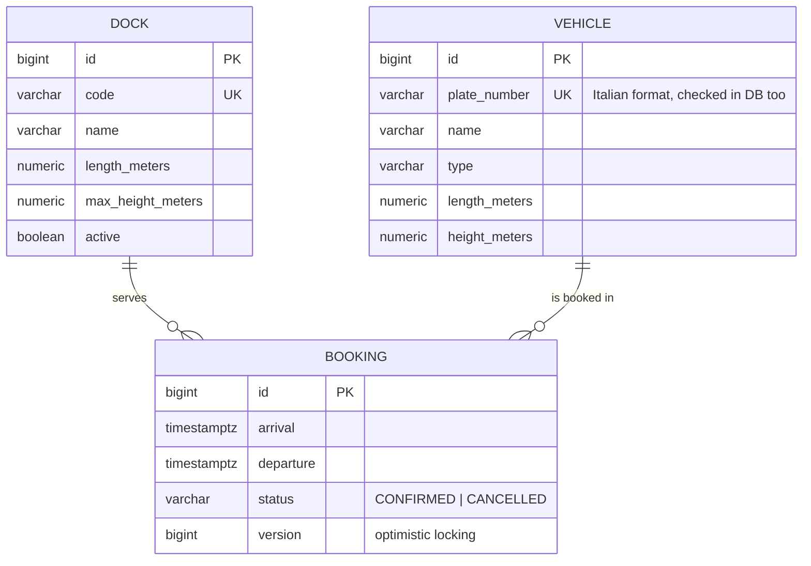

# Dock Planner · Warehouse loading dock scheduling API

[](https://github.com/michele872/dock-planner/actions/workflows/ci.yml)


A REST API that books **which loading dock each truck uses and when**. A warehouse has docks of different lengths and door heights, and vans, rigid trucks and articulated lorries arrive all day to load and unload. The API books a time slot at a dock and refuses anything that could not work in reality: a vehicle that is too long or too high for the dock, two vehicles at the same dock at the same time, or one vehicle at two docks at once.

It also answers the two questions a yard planner asks most often: **"when is this dock free?"** and **"where can this truck go?"**



---

## Business rules

| # | Rule | Response when broken |
|---|---|---|
| 1 | Departure must be after arrival | `400 Bad Request` |
| 2 | The dock must be in service, and the vehicle must fit it: length ≤ dock length, height ≤ door height | `422 Unprocessable Content` |
| 3 | A dock serves one vehicle at a time | `409 Conflict` with the ids of the clashing bookings |
| 4 | A vehicle cannot be booked at two docks at the same time | `409 Conflict` |
| 5 | Plates must be valid Italian plates (`AB123CD`, letters I, O, Q, U never used) | `400 Bad Request` with the invalid field |

Slots are **half-open intervals** `[arrival, departure)`: a truck can pull in at the exact minute the previous one leaves.

### Two layers of protection against double bookings

Rules 3 and 4 are checked in [`BookingService`](src/main/java/dev/magurno/dockplanner/booking/BookingService.java), which returns clear error messages. The service also locks the dock row (`SELECT … FOR UPDATE`) while it checks and saves.

The database enforces the same rules on its own, with **PostgreSQL exclusion constraints**. Two confirmed bookings with overlapping time ranges on the same dock, or for the same vehicle, are rejected even if a bug or a concurrent request bypasses the service:

```sql
CONSTRAINT booking_no_overlap_per_dock EXCLUDE USING gist (
    dock_id WITH =,
    tstzrange(arrival, departure) WITH &&
) WHERE (status = 'CONFIRMED')
```

A dedicated integration test saves an overlapping booking directly through the repository and checks that PostgreSQL refuses it.

### Planning helpers

- **Free slots**: `GET /api/docks/{id}/availability` returns the gaps between confirmed bookings in a period.
- **Suitable docks**: `GET /api/docks/suitable` returns the docks where a vehicle fits and that are free for the whole slot, **smallest first**, so the large docks stay available for articulated lorries.

## Tech stack

| Area | Technology |
|---|---|
| Language | Java 25 (records, text blocks) |
| Framework | Spring Boot 4.1: Spring MVC, Spring Data JPA (Hibernate 7), Bean Validation |
| Database | PostgreSQL 17, schema managed with **Flyway**, Hibernate in `validate` mode |
| API docs | OpenAPI 3.1 with springdoc, Swagger UI |
| Errors | RFC 9457 Problem Details (`application/problem+json`) |
| Tests | JUnit 5, AssertJ, `MockMvcTester`, **Testcontainers** (real PostgreSQL) |
| Delivery | Multi-stage Dockerfile (non-root runtime), Docker Compose, GitHub Actions |

---

## Getting started

**Requirements:** Docker with Docker Compose v2. Port `8081` must be free.

```bash
git clone https://github.com/michele872/dock-planner.git
cd dock-planner
docker compose up --build
```

Then open:

- **Swagger UI:** http://localhost:8081/swagger-ui.html
- **Health check:** http://localhost:8081/actuator/health

The `demo` profile loads a small fictional warehouse: 5 docks, 6 vehicles and a few bookings for tomorrow.

### Run the tests

Testcontainers starts PostgreSQL in Docker, so the only requirements are Java 25 and Docker:

```bash
./mvnw verify
```

31 tests: unit tests for the time-window logic and the plate format, and API integration tests against a real database. GitHub Actions runs them on every push.

---

## API

| Method | Endpoint | Description |
|---|---|---|
| `GET` | `/api/docks` | All docks |
| `POST` | `/api/docks` | Add a dock |
| `GET` | `/api/docks/{id}/availability?from=&to=` | Free periods of a dock |
| `GET` | `/api/docks/suitable?vehicleId=&arrival=&departure=` | Docks that can serve a vehicle, smallest first |
| `GET` | `/api/vehicles` | All vehicles |
| `POST` | `/api/vehicles` | Register a vehicle (plate validated) |
| `GET` | `/api/bookings?dockId=&from=&to=` | Schedule, by default the next 14 days |
| `GET` | `/api/bookings/{id}` | One booking |
| `POST` | `/api/bookings` | Book a dock |
| `POST` | `/api/bookings/{id}/cancel` | Cancel a booking and free the dock |

Times are ISO 8601 with an offset (`2030-06-14T08:00:00+02:00`) and are returned in UTC.

### Examples

These responses come from the demo data.

**Book a dock**

```bash
curl -X POST http://localhost:8081/api/bookings \
  -H "Content-Type: application/json" \
  -d '{"dockId": 2, "vehicleId": 3, "arrival": "2030-06-14T08:00:00+02:00", "departure": "2030-06-14T09:30:00+02:00"}'
```

```json
{
  "id": 7, "dockId": 2, "dockCode": "D2", "vehicleId": 3, "vehicleName": "Iveco Eurocargo · Freschi Nord",
  "arrival": "2030-06-14T06:00:00Z", "departure": "2030-06-14T07:30:00Z", "status": "CONFIRMED"
}
```

**The vehicle does not fit** (`422`)

```json
{
  "type": "urn:dock-planner:problem:business-rule",
  "title": "Business rule violated",
  "status": 422,
  "detail": "DAF XF · Autotrasporti Ferri (18.75 m long, 4.00 m high) does not fit dock D3 (12.50 m long, 4.00 m max height).",
  "instance": "/api/bookings"
}
```

**The dock is taken** (`409`)

```json
{
  "type": "urn:dock-planner:problem:conflict",
  "title": "Scheduling conflict",
  "status": 409,
  "detail": "Dock D2 is already booked in that period.",
  "instance": "/api/bookings",
  "conflictingBookingIds": [7]
}
```

**Invalid input** (`400`)

```json
{
  "type": "urn:dock-planner:problem:validation",
  "title": "Validation failed",
  "status": 400,
  "detail": "One or more fields are invalid.",
  "instance": "/api/vehicles",
  "errors": { "plateNumber": "must be a valid Italian licence plate, e.g. AB123CD" }
}
```

**Free slots of dock D2**

```bash
curl "http://localhost:8081/api/docks/2/availability?from=2030-06-14T00:00:00Z&to=2030-06-15T00:00:00Z"
```

```json
[
  { "start": "2030-06-14T00:00:00Z", "end": "2030-06-14T06:00:00Z" },
  { "start": "2030-06-14T07:30:00Z", "end": "2030-06-15T00:00:00Z" }
]
```

---

## Data model



## Project structure

Code is organised by feature, not by technical layer:

```
src/main/java/dev/magurno/dockplanner/
├── dock/         # Dock entity, repository (with row lock), REST controller
├── vehicle/      # Vehicle entity, plate validator, REST controller
├── booking/      # Booking entity, TimeWindow, BookingService (the rules), REST controller
├── common/       # Problem Details error handling, OpenAPI configuration
└── demo/         # demo data, active with the "demo" profile
src/main/resources/db/migration/
└── V1__create_schema.sql   # tables, checks and exclusion constraints
```

## Possible next steps

- Authentication and roles (yard planner, carrier, read-only) with Spring Security
- Dock capabilities (refrigerated, side loading, forklift) as extra constraints
- Carrier self-service booking of the first free slot
- A calendar UI on top of the API
- Events (booking confirmed or cancelled) published to a message broker

---

## Author

**Michele Magurno**, Full Stack Developer
[LinkedIn](https://www.linkedin.com/in/michele-magurno-583563106) · [GitHub](https://github.com/michele872)
